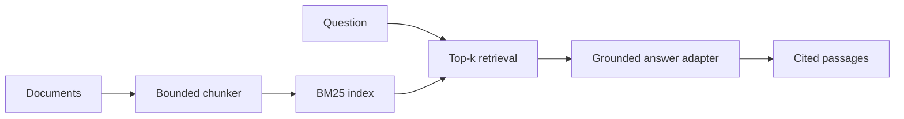

# Enterprise Knowledge Assistant

A citation-first retrieval augmented generation service designed around a key enterprise constraint: answers must be traceable to retrieved source passages. The local mode is deterministic and needs no API key. It returns evidence excerpts instead of pretending that a language model ran.

## Architecture



## Run

```bash
python -m venv .venv && source .venv/bin/activate
pip install -e '.[test]'
uvicorn knowledge_assistant.app:app --reload
```

Open `http://127.0.0.1:8000/docs`. Add a synthetic document with `POST /documents`, then query using `POST /query`.

### Optional Gemini on Vertex AI

Install `pip install -e '.[vertex]'`, configure Google Application Default Credentials, and set `GOOGLE_CLOUD_PROJECT`, `GOOGLE_CLOUD_LOCATION=global`, and `GEMINI_ENABLED=true`. Set `GEMINI_MODEL` to select a model. The app sends retrieved passages as untrusted evidence and asks for source-bounded answers. Generation is off by default; model-backed responses still need evaluation and review before use.

## Engineering decisions

- BM25 is implemented locally to keep retrieval inspectable and reproducible.
- Chunk sizes are bounded and overlap is validated.
- Retrieval scores are returned with citations for debugging and evaluation.
- Optional Gemini generation uses the Google Gen AI SDK on Vertex AI; model calls are disabled by default.
- Empty retrieval returns an explicit abstention.
- Duplicate document IDs fail with HTTP 409.
- The initial in-memory index is intentionally a demo adapter. For production, replace it with a tenant-aware persistent vector + keyword index, add auth, encryption, retention rules, and ingestion scanning.

## Tests

`pytest -q` covers chunk boundaries, retrieval ranking, citations, and abstention. No model access is required.
